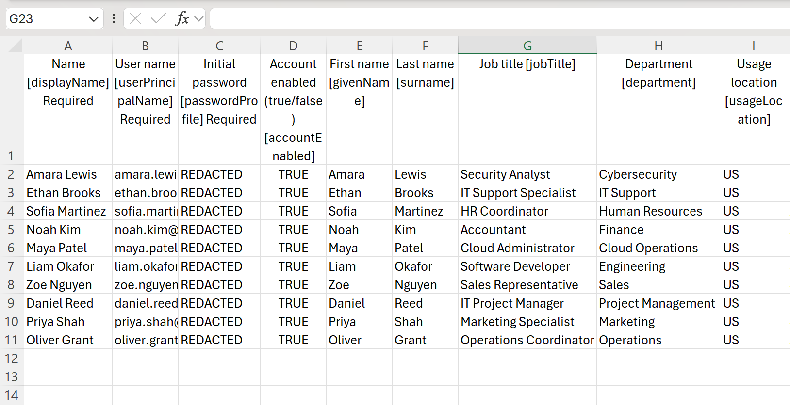
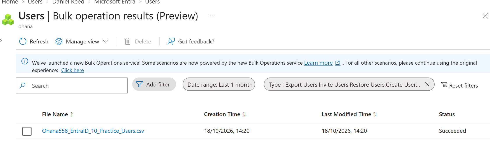
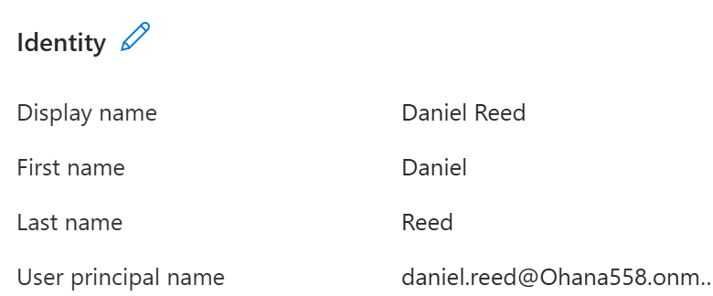
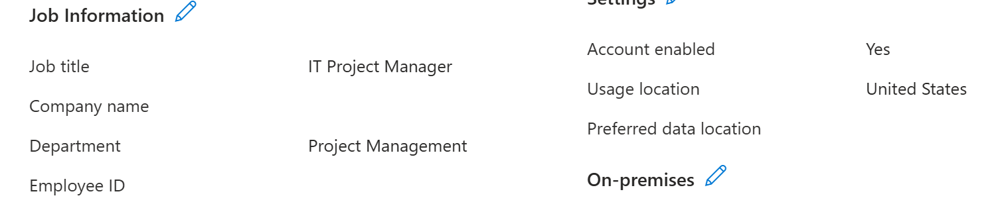

# Lab 01: Bulk User Provisioning in Microsoft Entra ID

## 1. Objective

The objective of this lab was to practice bulk user account provisioning in Microsoft Entra ID using a CSV (Comma-Separated Values) file.

Instead of creating accounts individually, I used the bulk user creation feature to provision 10 fictional employee accounts with different job titles and departments.

The lab focused on preparing a correctly formatted CSV template, performing the bulk creation operation, and verifying that the accounts and their attributes were successfully created.

## 2. Lab Environment

- **Platform:** Microsoft Entra ID
- **Administration portal:** Microsoft Entra admin center
- **Environment:** Dedicated practice tenant
- **Provisioning method:** CSV-based bulk user creation
- **Number of user accounts:** 10
- **Account type:** Member users
- **Verification methods:** Bulk operation results, user directory, and individual user properties

## 3. Security Relevance

Bulk user provisioning is an important identity and access management (IAM) administrative task. It allows organizations to create multiple user accounts efficiently while maintaining consistent user attributes such as departments, job titles, and account status.

Accurate user information also supports later administration tasks, including group membership management and targeting access or device management policies.

**Note:** All employee identities used in this lab are fictional. Initial passwords have been redacted from the publicly shared evidence.

## 4. Practical Implementation

### 4.1 Preparing the CSV File

I prepared a CSV file using the Microsoft Entra ID bulk user creation template.

The file contained 10 fictional employee accounts representing different departments, including IT Support, Cybersecurity, Human Resources, Finance, Engineering, and Project Management.

I populated the following user attributes:

- **Display name:** Full name of the employee.
- **User principal name (UPN):** Unique sign-in name using my Microsoft Entra ID practice domain.
- **Initial password:** Initial authentication credential assigned during account provisioning.
- **Account enabled:** Set to `TRUE` to enable the user accounts.
- **First name and last name:** Individual employee identity information.
- **Job title:** The employee's assigned organizational role.
- **Department:** The department associated with the employee.
- **Usage location:** Set to `US` for the practice accounts.

I saved the completed file in CSV format, ready for bulk provisioning.

*Figure 1: CSV template prepared for bulk user provisioning, showing user attributes with initial passwords redacted.*

### 4.2 Performing Bulk User Creation

After preparing the CSV file, I performed the bulk user creation operation using the Microsoft Entra admin center.

**Steps performed:**

1. Signed in to the Microsoft Entra admin center.
2. Navigated to **Entra ID → Users → Bulk create**.
3. Selected the option to upload a CSV file.
4. Uploaded my prepared file containing 10 employee accounts.
5. Submitted the bulk creation operation.
6. Navigated to **Bulk operation results** to check the operation status.

The bulk operation completed with a **Succeeded** status.

*Figure 2: Microsoft Entra ID bulk operation results confirming that the CSV-based user creation operation completed successfully.*

### 4.3 Verifying the Created Accounts

After completing the import, I verified the results in the Microsoft Entra admin center.

**Verification steps:**

1. Navigated to **Entra ID → Users → All users**.
2. Confirmed that the newly created practice accounts appeared in the user directory.
3. Opened an individual user account to inspect its properties.
4. Verified the user identity, assigned job title, department, and account status.
5. 

*Figure 3: Microsoft Entra ID user directory displaying the newly provisioned practice accounts following the successful bulk import.*

**Example verification — Daniel Reed**

- **Display name:** Daniel Reed
- **User type:** Member
- **Job title:** IT Project Manager
- **Department:** Project Management
- **Account enabled:** Yes
- **Usage location:** United States

*Figure 4A: Verification of the newly created user's identity attributes, including display name, first name, last name, and user principal name.*

*Figure 4B: Verification of Daniel Reed's job title, Project Management department, enabled account status, and usage location in Microsoft Entra ID.*
  
  

**Result:** The bulk creation operation succeeded, the 10 practice accounts appeared in the directory, and the inspected sample account contained the expected attributes.
