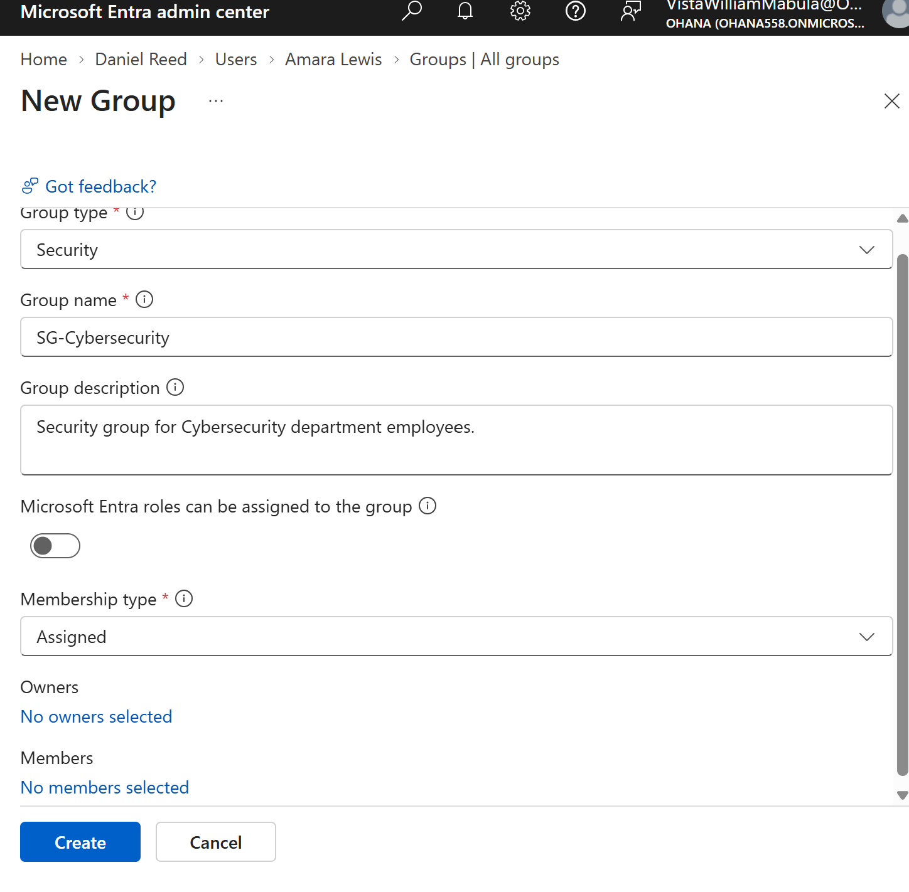
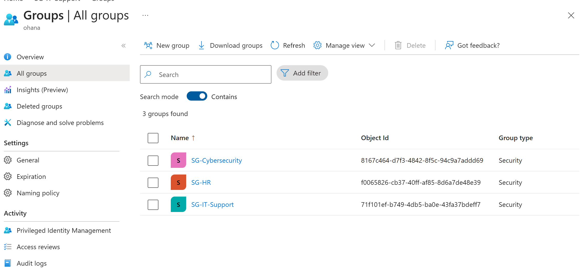
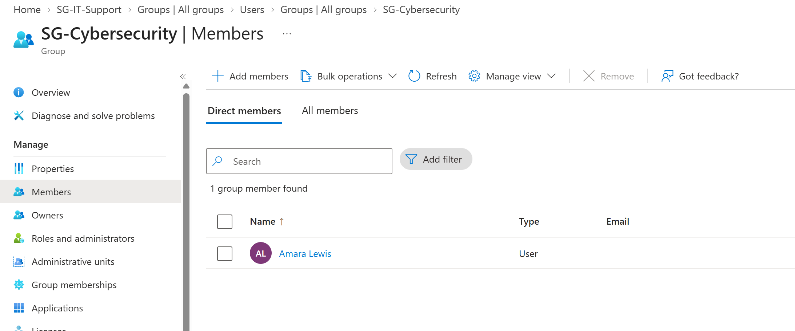
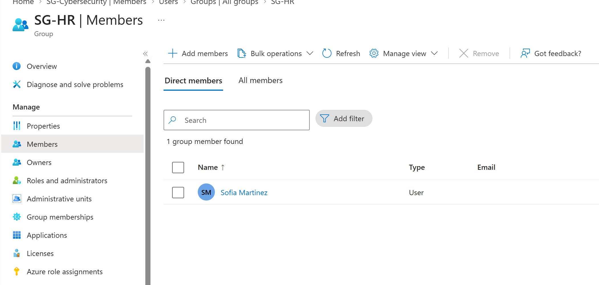
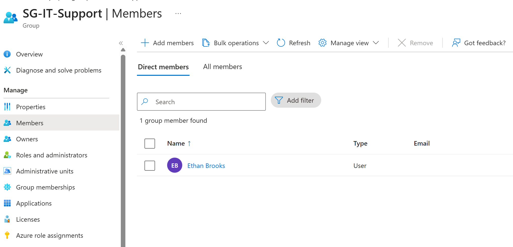
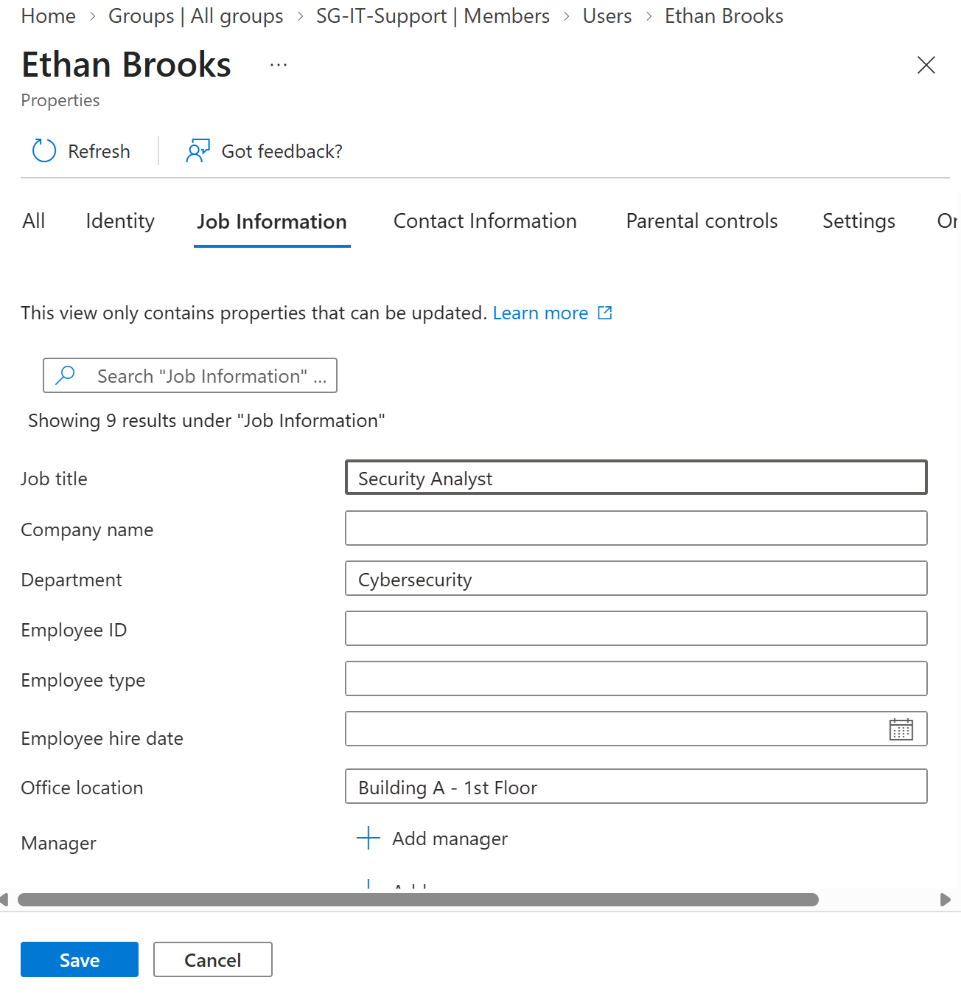
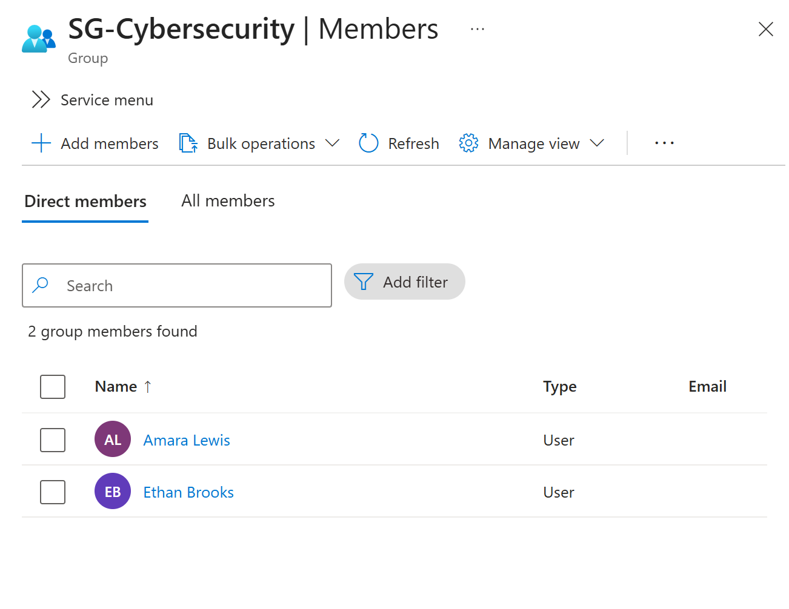
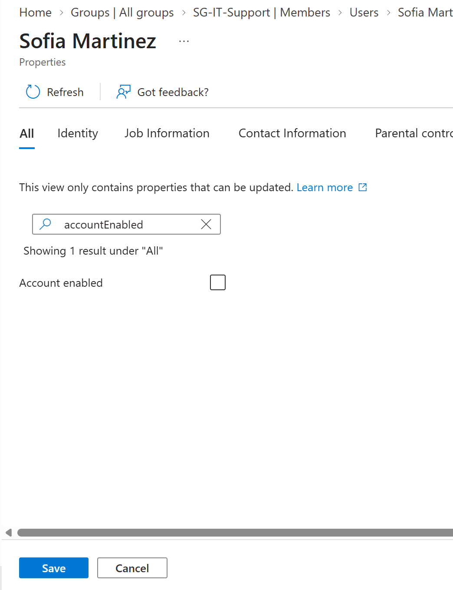
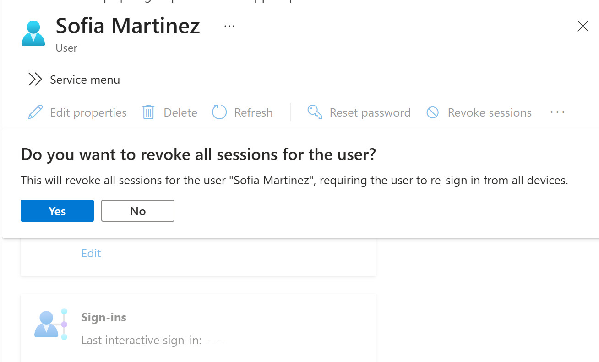
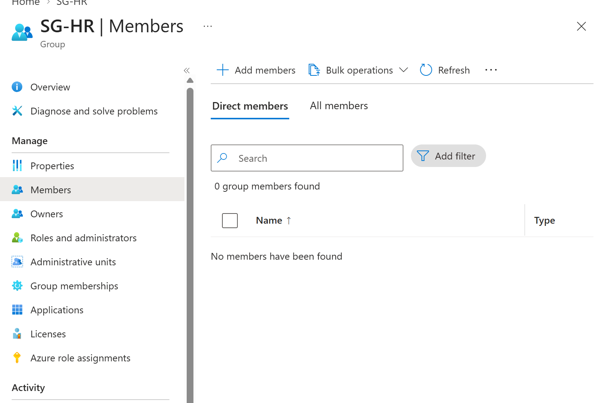

# Lab 02: Microsoft Entra ID — User Lifecycle Management

## Objective

Practice identity lifecycle management in Microsoft Entra ID, focusing on employee onboarding, access modifications, and offboarding.

**Environment:** Microsoft Entra ID | Ohana Lab Tenant

## 1. Security Group Creation

Created three security groups with assigned membership to organize employees by department:

- SG-Cybersecurity
- SG-HR
- SG-IT-Support

*Figure 1: Configuring a security group with assigned membership.*

*Figure 2: Three security groups successfully created.*

## 2. Employee Onboarding

Assigned three employees to their respective security groups:

**Amara Lewis — Cybersecurity**

*Figure 3: Amara Lewis assigned to SG-Cybersecurity.*

**Sofia Martinez — Human Resources**

*Figure 4: Sofia Martinez assigned to SG-HR.*

**Ethan Brooks — IT Support**

*Figure 5: Ethan Brooks assigned to SG-IT-Support.*

## 3. Access Modification — Ethan Brooks

**Scenario:** Ethan transfers from IT Support to Cybersecurity.

Updated his job title to Security Analyst and department to Cybersecurity.

*Figure 6: Updating Ethan's job information.*

Added Ethan to SG-Cybersecurity to reflect his new department.

*Figure 7: Ethan and Amara listed as Cybersecurity group members.*

**Security principle:** Group memberships should be reviewed whenever an employee changes roles to prevent unnecessary access.

## 4. Employee Offboarding — Sofia Martinez

**Scenario:** Sofia leaves the organization.

### Disable Account

Configured Sofia's account to prevent further sign-ins.

*Figure 8: Disabling Sofia's Entra ID account.*

### Revoke Sessions

Initiated session revocation to invalidate Sofia's existing sign-in sessions.

*Figure 9: Session revocation confirmation prompt.*

### Remove Group Membership

Removed Sofia from SG-HR.

*Figure 10: SG-HR showing zero members after Sofia's removal.*

## 5. Security Concepts Practiced

- Identity and Access Management (IAM)
- User lifecycle management (Joiner–Mover–Leaver)
- Security group management
- Role-based access principles
- Least privilege
- Account disabling and session revocation

## 6. Key Takeaways

Microsoft Entra ID enables administrators to manage user identities throughout their employment lifecycle. Updating memberships when roles change and revoking access during offboarding helps reduce the risk of unauthorized access.

**Reference:** [Microsoft Learn — Create and manage users and groups](https://learn.microsoft.com/en-gb/training/modules/configure-entraid-device-management/03-create-manage-users-groups)
