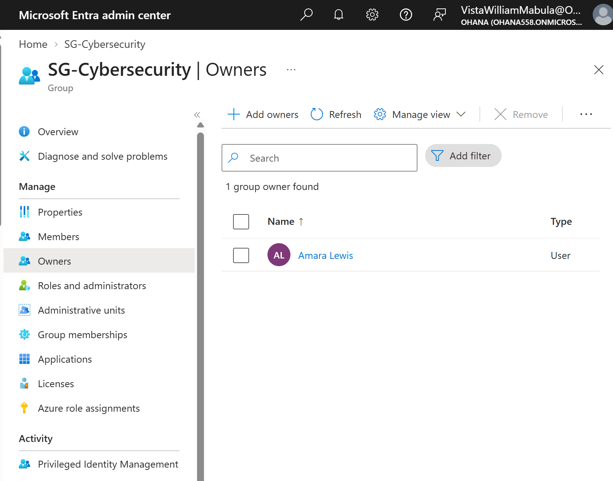
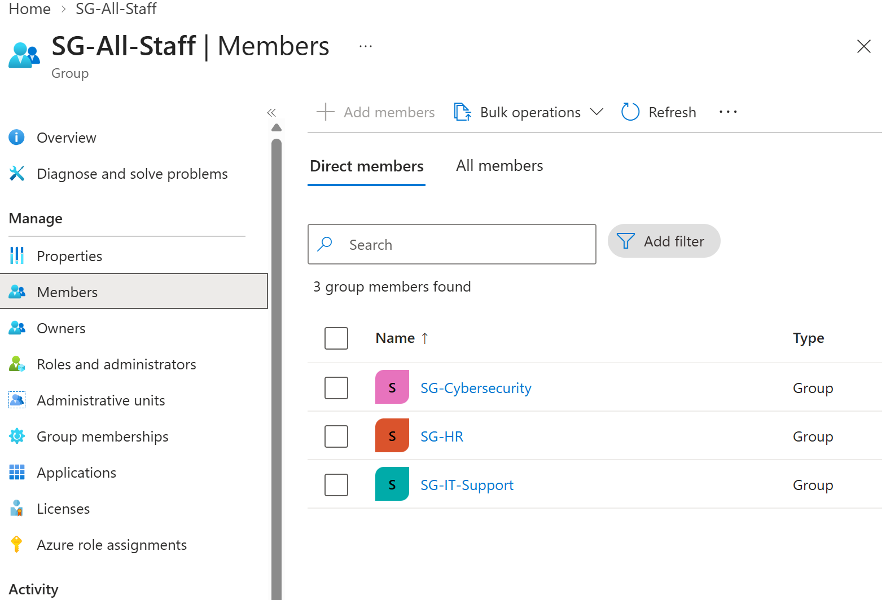

# Lab 03: Microsoft Entra ID — Group Ownership and Hierarchy

## Objective

Practice delegated group administration and nested security group management using Microsoft Entra ID.

## 1. Group Ownership

**Scenario:** Assign Amara Lewis as the owner of the SG-Cybersecurity security group.

**Actions performed:**
1. Opened SG-Cybersecurity in Microsoft Entra ID.
2. Navigated to Owners.
3. Assigned Amara Lewis as a group owner.
4. Verified that Amara appeared in the Owners list.

*Figure 1: Amara Lewis assigned as owner of SG-Cybersecurity.*

**Security concept:** Delegated administration allows authorized group owners to manage membership without receiving tenant-wide administrative privileges.

## 2. Group Hierarchy

**Scenario:** Organize departmental security groups under one parent group.

**Actions performed:**
1. Created SG-All-Staff as a security group.
2. Selected Assigned membership.
3. Added SG-Cybersecurity, SG-HR, and SG-IT-Support as child groups.
4. Verified all three groups appeared in the parent group's membership list.

*Figure 2: Three departmental security groups nested under SG-All-Staff.*

**Security concept:** Nested security groups simplify identity organization. Support for indirect membership varies between Microsoft services and policy types.

## 3. Key Takeaways

- Practiced delegated ownership of security groups.
- Created and verified nested security groups.
- Explored least-privilege administration.
- Learned how group ownership differs from group membership.
- Understood that nested group membership does not guarantee automatic policy inheritance.

**Platform:** Microsoft Entra ID  
**Environment:** Ohana Lab Tenant  
**Project:** Microsoft Endpoint Security Lab
