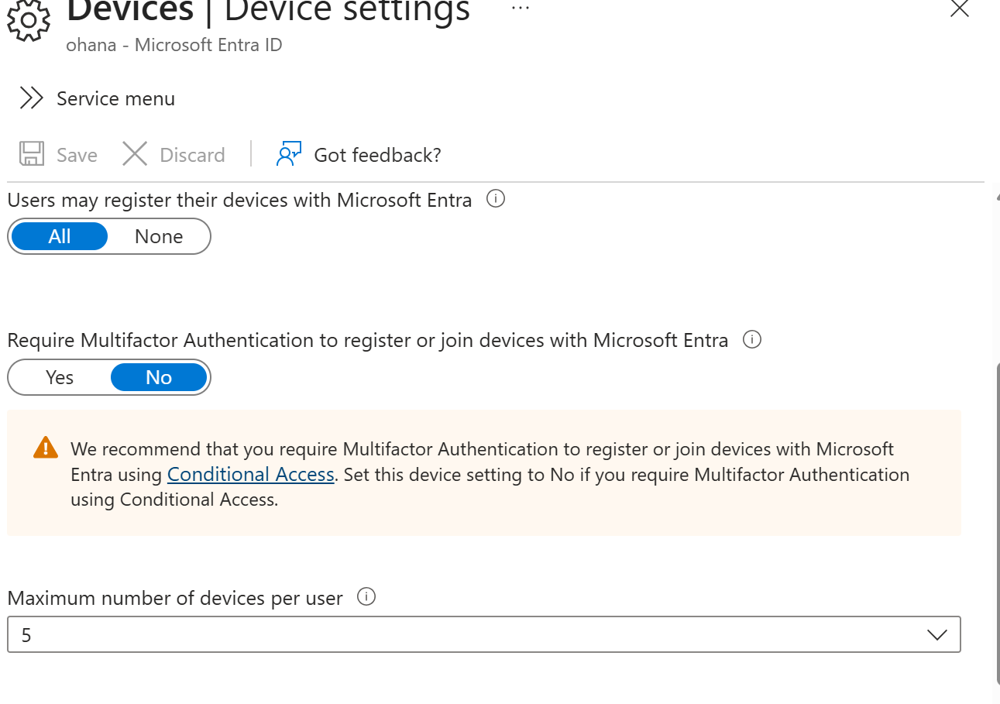

# Lab 04: Microsoft Entra ID Device Registration

## 1. Restricting Device Join Permissions

**Objective:** Restrict device joining to authorized employees.

**Actions performed:**
1. Reviewed existing device registration settings.
2. Changed device join permissions from All to Selected.
3. Selected SG-Cybersecurity as the authorized group.
4. Saved and verified the configuration.

*Figure 1: Default device registration settings.*

*Figure 2: Device joining restricted to SG-Cybersecurity.*

**Security concept:** Limiting device join permissions helps reduce unauthorized device enrollment.
## 2. Device Limit Configuration

**Objective:** Restrict the number of devices per user.

**Actions performed:**
1. Opened Microsoft Entra device settings.
2. Changed the device limit from 50 to 5.
3. Saved and verified the configuration.

*Figure 3: Maximum device limit configured to five.*

**Security concept:** Device limits help control the number of devices associated with each user account.
## 3. Device Registration and MFA

**Objective:** Review device registration permissions and MFA security controls.

**Actions performed:**
1. Reviewed Microsoft Entra device registration settings.
2. Confirmed device registration was set to All.
3. Identified Conditional Access as the recommended method for enforcing MFA during device registration.

**Security concept:** MFA helps prevent unauthorized device registration using compromised credentials.
