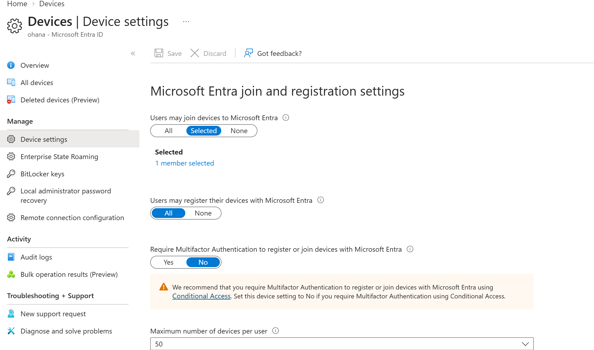
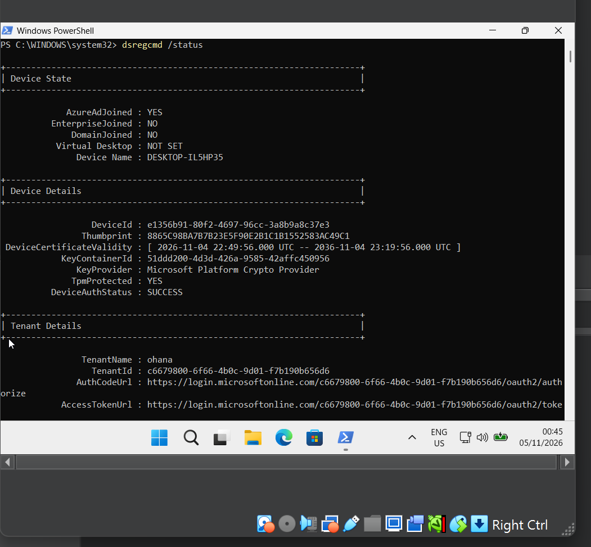
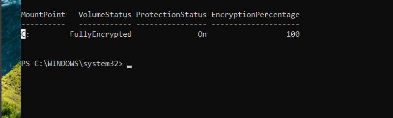

# Lab 04: Microsoft Entra ID Device Registration

## 1. Restricting Device Join Permissions

**Objective:** Restrict device joining to authorized employees.

**Actions performed:**
1. Reviewed existing device registration settings.
2. Changed device join permissions from All to Selected.
3. Selected SG-Cybersecurity as the authorized group.
4. Saved and verified the configuration.

*Figure 1: Default device registration settings.*

*Figure 2: Device joining restricted to SG-Cybersecurity.*

**Security concept:** Restricting Microsoft Entra device joining to authorized security groups supports least privilege and reduces unauthorized device joins.
## 2. Device Limit Configuration

**Objective:** Restrict the number of devices per user.

**Actions performed:**
1. Opened Microsoft Entra device settings.
2. Changed the device limit from 50 to 5.
3. Saved and verified the configuration.

*Figure 3: Maximum device limit configured to five.*

**Security concept:** Limiting the number of devices per user helps organizations control device registrations and joins, reducing unnecessary device associations.
## 3. Device Registration and MFA

**Objective:** Review device registration permissions and MFA security controls.

**Actions performed:**
1. Reviewed Microsoft Entra device registration settings.
2. Confirmed device registration was set to All.
3. Identified Conditional Access as the recommended method for enforcing MFA during device registration.

**Security concept:** MFA adds an additional layer of identity verification, helping protect device registration against unauthorized access.
### 3.1 Conditional Access Licensing

**Objective:** Verify licensing requirements for Conditional Access.

**Actions performed:**
- Reviewed Microsoft Entra licensing.
- Confirmed availability of Microsoft Entra ID P2.
- Identified available licenses for testing Conditional Access.

**Security concept:** Conditional Access enables identity-based access controls, including MFA requirements for device registration.
### 3.2 Conditional Access — Device Registration MFA

**Objective:** Configure an MFA policy for device registration.

**Actions performed:**
1. Created a Conditional Access policy.
2. Selected the device registration/join action.
3. Configured multifactor authentication.
4. Saved the policy in Report-only mode.

**Result:** Successfully created a Conditional Access policy requiring MFA for device registration, configured in Report-only mode. MFA enforcement was not tested.

### 4. Local Administrator Security

**Objective:** Review local administrator privileges on Microsoft Entra joined devices.

**Actions performed:**
1. Reviewed local administrator settings.
2. Confirmed automatic local administrator assignment was set to None.
3. Identified the additional local administrator management option.

**Result:** Confirmed that automatic local administrator assignment was set to None and that the Device Administrators role initially had no assigned users.

**Security concept:** Applying least privilege helps prevent unnecessary administrative access to Windows devices.

### 5. Windows LAPS Configuration

**Objective:** Enable Windows Local Administrator Password Solution (LAPS).

**Actions performed:**
1. Opened Microsoft Entra device settings.
2. Enabled Windows LAPS.
3. Verified the configuration.

*Figure 8: Windows LAPS enabled in Microsoft Entra ID.*

**Intune LAPS Policy — Access Limitation**

Attempted to configure Windows LAPS through Microsoft Intune but encountered an access restriction.

**Result:** Successfully enabled LAPS in Microsoft Entra ID. Subsequently configured LAPS locally using PowerShell and verified password backup in Section 10.

**Security concept:** Windows LAPS supports secure local administrator password management and rotation.
### 6. BitLocker Recovery Key Management

**Objective:** Explore BitLocker recovery key management in Microsoft Entra ID.

**Actions performed:**
1. Checked Entra ID for registered or joined devices.
2. Initially found no devices available.
3. Later joined a Windows 11 virtual machine and continued BitLocker testing in Section 9.

**Result:** Successfully verified BitLocker encryption and located the recovery-key retrieval option after registering the test device.

**Security concept:** BitLocker protects stored data through encryption, while recovery keys enable authorized recovery of encrypted drives.
### 7. Enterprise State Roaming (ESR)

**Objective:** Review Windows settings synchronization management.

**Actions performed:**
1. Opened Enterprise State Roaming in Microsoft Entra ID.
2. Identified Microsoft's migration to Windows settings backup and restore.
3. Reviewed the available management options.

**Result:** Reviewed Enterprise State Roaming and identified Microsoft's transition to Windows settings backup and restore. No configuration changes were performed due to the migration of management settings.

**Security concept:** Centralized settings management helps organizations maintain consistent device configurations and manage Windows settings synchronization.
### 8. Windows Device Join

**Objective:** Connect a dedicated Windows test device to Microsoft Entra ID.

**Actions performed:**
1. Installed Windows 11 Enterprise Evaluation in VirtualBox.
2. Joined the VM to Microsoft Entra ID using Amara Lewis's account.
3. Verified the connection using `dsregcmd /status`.
4. Confirmed `AzureAdJoined: YES` and `DeviceAuthStatus: SUCCESS`.
5. Verified the device appeared in Microsoft Entra Admin Center.

**Result:** Successfully joined and authenticated a Windows 11 virtual machine to Microsoft Entra ID.

*Figure 9: Windows test device successfully joined to Microsoft Entra ID.*

**Security concept:** Microsoft Entra device identities enable centralized device authentication and access management.
### 9. BitLocker Encryption and Recovery

**Objective:** Verify BitLocker protection and recovery-key availability.

**Actions performed:**
1. Checked BitLocker status using PowerShell.
2. Confirmed the C: drive was fully encrypted.
3. Verified BitLocker protection was enabled.
4. Located the recovery-key retrieval option in Microsoft Entra ID.

*Figure 12: BitLocker encryption verified at 100%.*

**Verification results:**
- Volume status: FullyEncrypted
- Protection status: On
- Encryption percentage: 100%
- Recovery-key retrieval option available in Microsoft Entra ID.

**Result:** Successfully verified BitLocker encryption and located the device's recovery-key information in Microsoft Entra ID.

**Security concept:** BitLocker protects data at rest through encryption, while recovery keys enable authorized access when normal unlocking is unavailable.
### 10. Windows LAPS Password Management

**Objective:** Configure and verify local administrator password backup using Windows LAPS.

**Actions performed:**

1. Enabled Windows LAPS in Microsoft Entra ID.
2. Configured the local LAPS policy using PowerShell.
3. Investigated Event ID 10067, identifying a disabled Administrator account.
4. Enabled the Administrator account and verified its status.
5. Confirmed an earlier successful password backup using Event ID 10029.
6. Verified the device's recovery information and password rotation schedule in Microsoft Entra ID.

*Figure 13: Windows LAPS recovery information and password rotation schedule.*

**Result:** Successfully verified that Windows LAPS recovery information was stored in Microsoft Entra ID. The Administrator account was enabled, but subsequent warning-free policy processing was not verified.

**Security concept:** Windows LAPS improves endpoint security by managing local administrator passwords through secure backup and rotation.

### 11. Administrator Privilege Removal

**Objective:** Apply the principle of least privilege.

**Actions performed:**
1. Reviewed temporary device administrator permissions.
2. Removed Maya Patel from the Device Administrators role.
3. Verified the role assignment was removed.

**Security concept:** Removing unnecessary privileges reduces security risks and limits potential unauthorized access.
## Lab 04 — Summary and Key Takeaways

This lab explored Microsoft Entra ID device registration and endpoint security through hands-on configuration and testing.

**Practical skills demonstrated:**
- Device registration and join restrictions
- Conditional Access MFA policy configuration (Report-only)
- Microsoft Entra device joining
- Local administrator privilege management
- BitLocker encryption verification
- Windows LAPS password backup and recovery
- Troubleshooting using Windows PowerShell and event logs

**Challenges encountered:**
- Limited access to Microsoft Intune
- Local administrator permission restrictions
- Windows LAPS Event ID 10067 caused by a disabled administrator account

**Outcome:** Successfully joined a Windows 11 virtual machine to Microsoft Entra ID, verified BitLocker protection and LAPS recovery information, and removed temporary tenant-wide administrative privileges.

**Limitations:** MFA enforcement, Intune policy deployment, and automatic LAPS password rotation were not tested.

**Key lesson:** Secure device administration requires proper identity configuration, least-privilege access, encryption, credential management, and verification through system logs.
