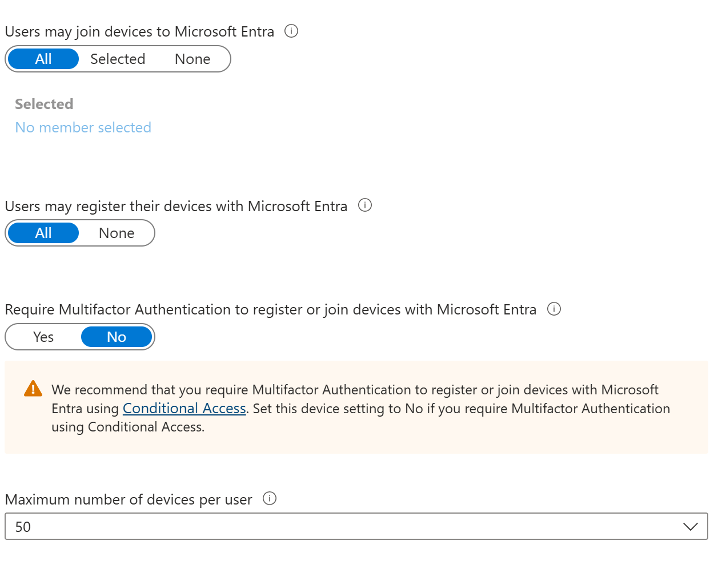
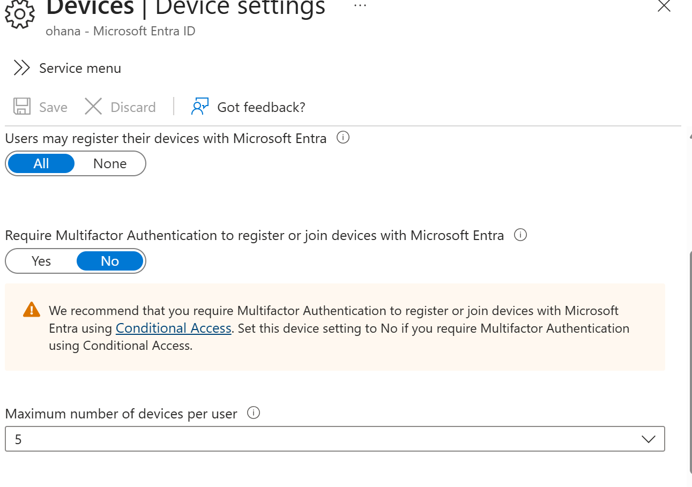
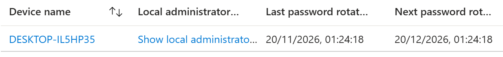

# Lab 04: Microsoft Entra ID Device Registration

## 1. Restricting Device Join Permissions

**Objective:** Restrict device joining to authorized employees.

**Actions performed:**
1. Reviewed existing device registration settings.
2. Changed device join permissions from All to Selected.
3. Selected SG-Cybersecurity as the authorized group.
4. Saved and verified the configuration.

*Figure 1: Default device registration settings.*

*Figure 2: Device joining restricted to SG-Cybersecurity.*

**Security concept:** Limiting device join permissions helps reduce unauthorized device enrollment.
## 2. Device Limit Configuration

**Objective:** Restrict the number of devices per user.

**Actions performed:**
1. Opened Microsoft Entra device settings.
2. Changed the device limit from 50 to 5.
3. Saved and verified the configuration.

*Figure 3: Maximum device limit configured to five.*

**Security concept:** Device limits help control the number of devices associated with each user account.
## 3. Device Registration and MFA

**Objective:** Review device registration permissions and MFA security controls.

**Actions performed:**
1. Reviewed Microsoft Entra device registration settings.
2. Confirmed device registration was set to All.
3. Identified Conditional Access as the recommended method for enforcing MFA during device registration.

**Security concept:** MFA helps prevent unauthorized device registration using compromised credentials.
### 3.1 Conditional Access Licensing

**Objective:** Verify licensing requirements for Conditional Access.

**Actions performed:**
- Reviewed Microsoft Entra licensing.
- Confirmed availability of Microsoft Entra ID P2.
- Identified available licenses for testing Conditional Access.

**Security concept:** Conditional Access enables identity-based access controls, including MFA requirements for device registration.
### 3.2 Conditional Access — Device Registration MFA

**Objective:** Configure an MFA policy for device registration.

**Actions performed:**
1. Created a Conditional Access policy.
2. Selected the device registration/join action.
3. Configured multifactor authentication.
4. Saved the policy in Report-only mode.

**Result:** Policy created successfully without enforcing MFA.

### 4. Local Administrator Security

**Objective:** Review local administrator privileges on Microsoft Entra joined devices.

**Actions performed:**
1. Reviewed local administrator settings.
2. Confirmed automatic local administrator assignment was set to None.
3. Identified the additional local administrator management option.

**Security concept:** Least privilege reduces unnecessary administrative access to devices.

**Result:** Verified that no users were directly assigned to the Microsoft Entra Joined Device Local Administrator role, reducing unnecessary privileged access.

### 5. Windows LAPS Configuration

**Objective:** Enable Windows Local Administrator Password Solution (LAPS).

**Actions performed:**
1. Opened Microsoft Entra device settings.
2. Enabled Windows LAPS.
3. Verified the configuration.

*Figure 8: Windows LAPS enabled in Microsoft Entra ID.*

**Security concept:** Windows LAPS helps protect local administrator accounts through secure password backup and rotation.

**Intune LAPS Policy — Access Limitation**

Enabled Windows LAPS in Microsoft Entra ID. Attempted to access Endpoint Security in Microsoft Intune but encountered an access restriction.

**Status:** Tenant-level LAPS enabled; device policy deployment not completed.
### 6. BitLocker Recovery Key Management

**Objective:** Explore BitLocker recovery key management in Microsoft Entra ID.

**Actions performed:**
1. Opened Entra ID → Devices → All devices.
2. Checked for registered or joined devices.
3. Found no devices available.

**Result:** Recovery key management could not be tested because no devices were enrolled or registered.

**Security concept:** BitLocker protects data through encryption, while recovery keys help restore access when necessary.
### 7. Enterprise State Roaming (ESR)

**Objective:** Review Windows settings synchronization management.

**Actions performed:**
1. Opened Enterprise State Roaming in Microsoft Entra ID.
2. Identified Microsoft's migration to Windows settings backup and restore.
3. Reviewed the available management options.

**Result:** Configuration not performed because ESR is no longer managed through the Entra Admin Center.

**Security concept:** Centralized management helps organizations control the synchronization and backup of Windows settings.
### 8. Windows Device Join

**Objective:** Connect a dedicated Windows test device to Microsoft Entra ID.

**Actions performed:**
1. Created a Windows 11 test environment.
2. Joined the device using an authorized user account.
3. Verified its registration in Microsoft Entra ID.

*Figure 9: Windows test device successfully joined to Microsoft Entra ID.*

**Security concept:** Device identities support centralized access control and device security management.
### 9. BitLocker Encryption and Recovery

**Objective:** Verify BitLocker protection and recovery-key availability.

**Actions performed:**
1. Checked BitLocker status using PowerShell.
2. Confirmed the C: drive was fully encrypted.
3. Verified BitLocker protection was enabled.
4. Located the recovery-key retrieval option in Microsoft Entra ID.

*Figure 12: BitLocker encryption verified at 100%.*

**Security concept:** BitLocker protects stored data through encryption and supports recovery using securely stored recovery keys.
### 10. Windows LAPS Password Management

**Objective:** Configure and verify local administrator password backup.

**Actions performed:**
1. Enabled Windows LAPS in Microsoft Entra ID.
2. Configured local LAPS policy using PowerShell.
3. Investigated Event ID 10067 (disabled Administrator account).
4. Verified successful password backup using Event ID 10029.
5. Located the device and password rotation schedule in Microsoft Entra ID.

*Figure 13: Windows LAPS recovery information and password rotation schedule.*

**Result:** Password backup confirmed. Follow-up verification of the account-disabled warning is pending.
### 11. Administrator Privilege Removal

**Objective:** Apply the principle of least privilege.

**Actions performed:**
1. Reviewed temporary device administrator permissions.
2. Removed Maya Patel from the Device Administrators role.
3. Verified the role assignment was removed.

**Security concept:** Removing unnecessary privileges reduces security risks and limits potential unauthorized access.
