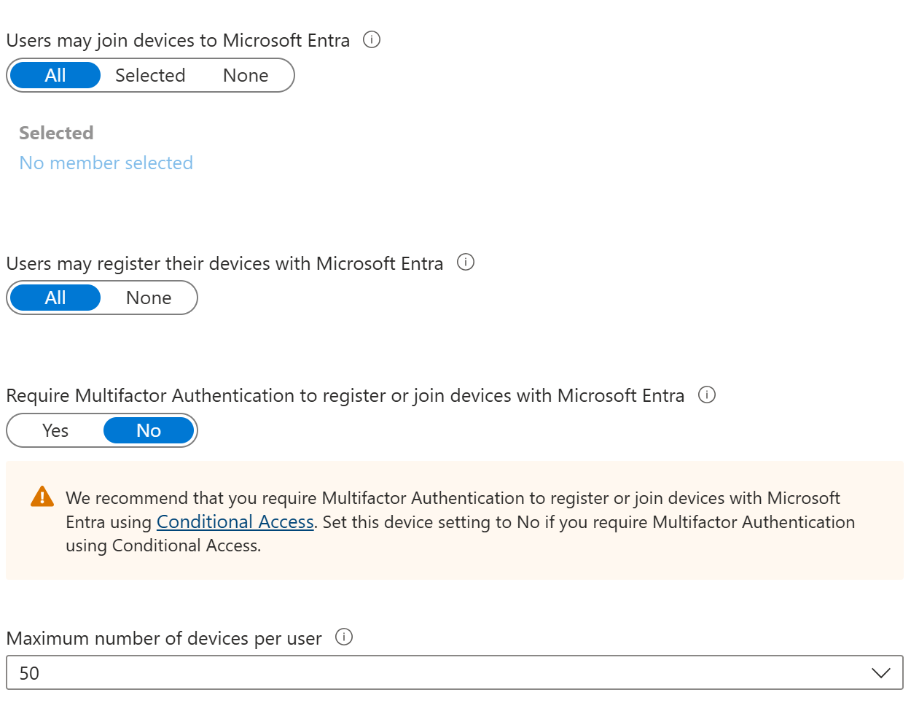
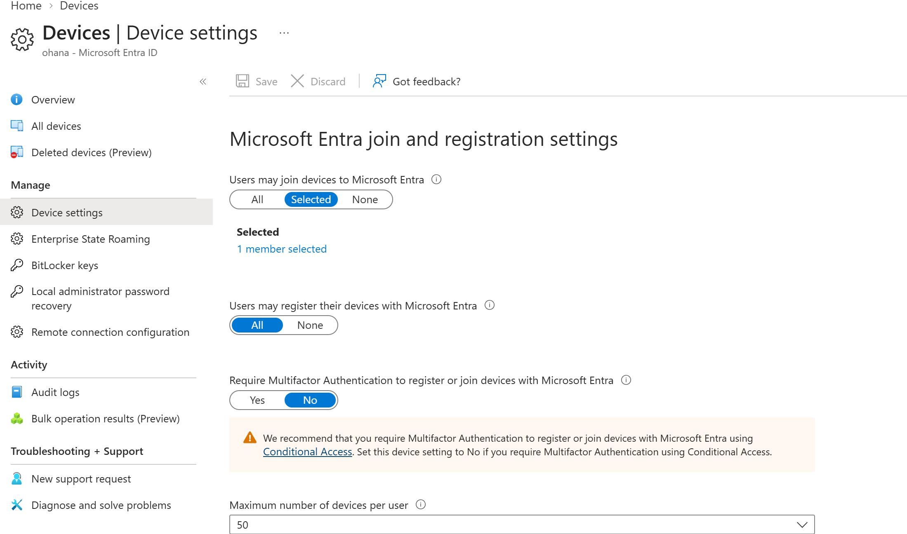

# Lab 04: Microsoft Entra ID Device Registration

## 1. Restricting Device Join Permissions

**Objective:** Restrict device joining to authorized employees.

**Actions performed:**
1. Reviewed existing device registration settings.
2. Changed device join permissions from All to Selected.
3. Selected SG-Cybersecurity as the authorized group.
4. Saved and verified the configuration.

*Figure 1: Default device registration settings.*

*Figure 2: Device joining restricted to SG-Cybersecurity.*

**Security concept:** Limiting device join permissions helps reduce unauthorized device enrollment.
